<!--
  The whole profile is one animated SVG: assets/terminal.svg, built by scripts/
  (cd scripts && npm install && npm run build). It refreshes daily with live
  GitHub activity via .github/workflows/refresh.yml.
-->

  <a href="https://jonathanrbt.lat"><code>~/portafolio</code></a> ·
  <a href="https://www.linkedin.com/in/jonathan-romero-b2044a303"><code>~/linkedin</code></a> ·
  <a href="mailto:jonathanstiwarromerobetancourt@gmail.com"><code>~/email</code></a>
   
  
    <a href="https://gambitoai.pages.dev/"><code>gambito</code></a>
    <a href="https://github.com/Organization-Jojun/jojun-cli"><code>jojun-cli</code></a>
    <a href="https://github.com/Jonathanrbt/platform-migratory-frontend"><code>platform-migratory</code></a>
    <a href="https://web-production-9f9d1.up.railway.app/"><code>adkio</code></a>
    <a href="https://sniff-plum.vercel.app/"><code>sniff</code></a>
  

