<!--
  Every image here is an animated SVG generated from the portfolio content.
  To update it: edit scripts/data.mjs, then `cd scripts && npm install && npm run build`.
-->

  
  
  
  
  

  
  
  
  
  

