<!--
  Every image here is an animated SVG built by scripts/ (cd scripts && npm install && npm run build).
  now.svg and constellation.svg refresh daily from the GitHub API (.github/workflows/refresh.yml).
-->

  
    <a href="https://gambitoai.pages.dev/">gambito</a> ·
    <a href="https://github.com/Organization-Jojun/jojun-cli">jojun-cli</a> ·
    <a href="https://github.com/Jonathanrbt/platform-migratory-frontend">platform-migratory</a> ·
    <a href="https://web-production-9f9d1.up.railway.app/">adkio</a> ·
    <a href="https://sniff-plum.vercel.app/">sniff</a>
  

  
  
  

